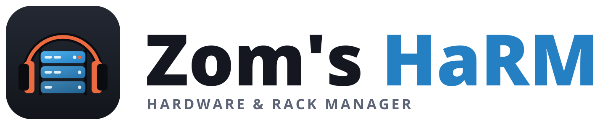
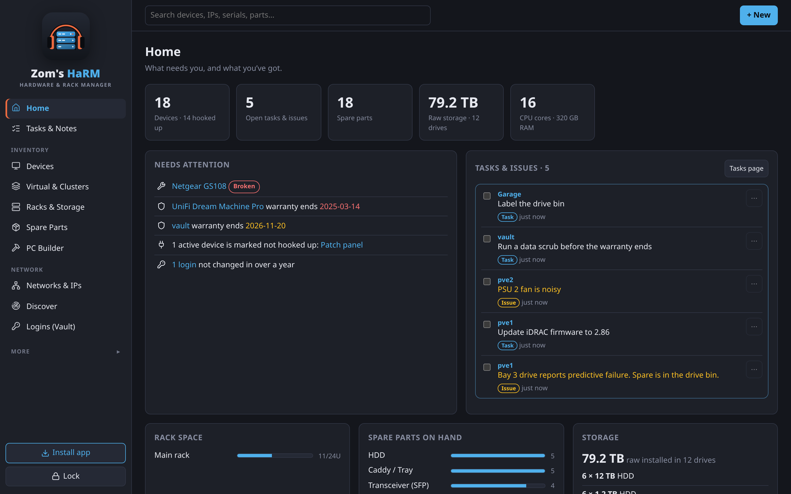
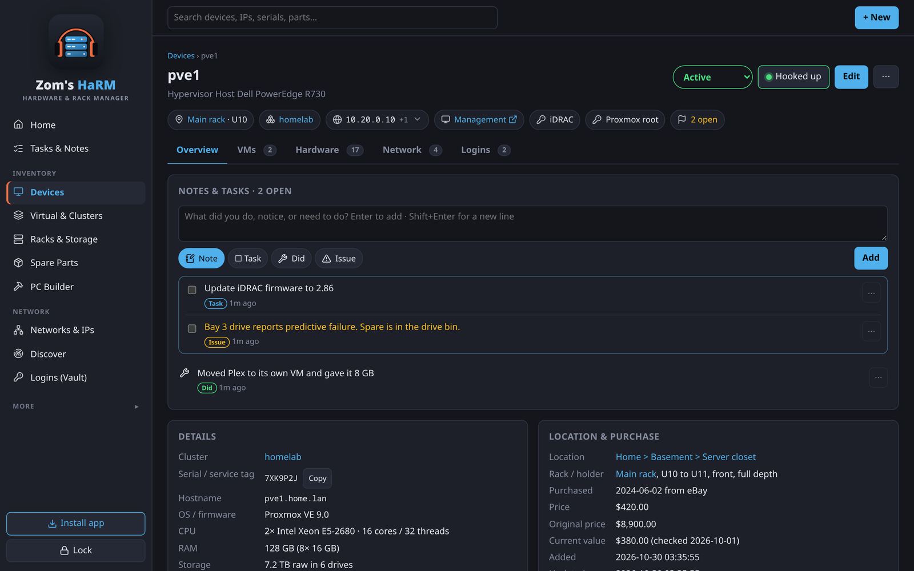
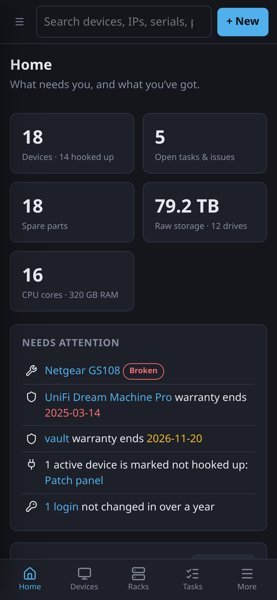
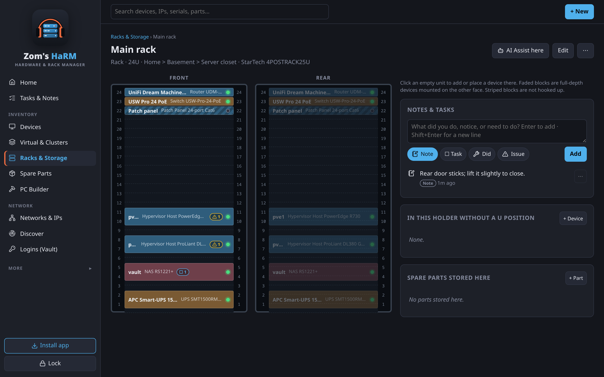
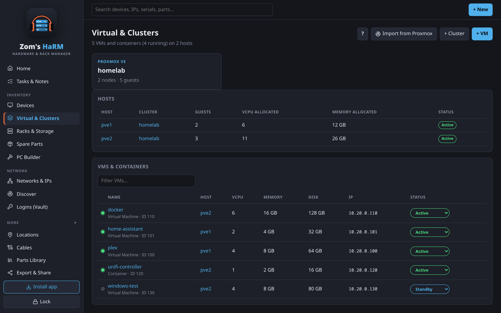
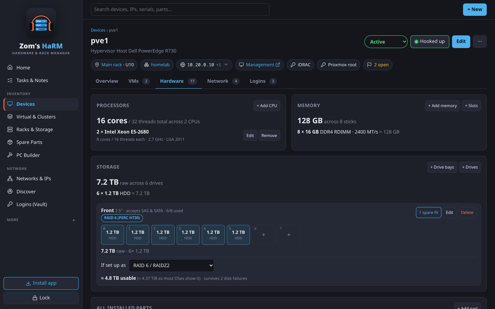

<p align="center">
  <picture>
    <source media="(prefers-color-scheme: dark)" srcset="branding/harm-logo-dark.png">
    
  </picture>
</p>

<p align="center">
  <b>Know where every piece of hardware is.</b><br>
  A free hardware and rack manager for your home lab: racks, devices, spare parts, networks, VMs and logins in one place.<br>
  Runs on Windows, Linux or your own server with Docker, and on your phone over your Wi‑Fi.
</p>

<p align="center">
  <a href="https://github.com/ZomBeatz/Zoms-HaRM/releases/latest"></a>
  <a href="https://github.com/ZomBeatz/Zoms-HaRM/releases/latest"></a>
  <a href="https://docs.zombeatzmedia.com/harm/"></a>
  <a href="#try-it-with-demo-data"></a>
  <a href="#running-on-a-server"></a>
</p>

<p align="center">
  
</p>

## Quick start

1. **Download** the file for your computer from the [latest release](https://github.com/ZomBeatz/Zoms-HaRM/releases/latest) (under **Assets** at the bottom):

   | Your computer | File to download | Then |
   |---|---|---|
   | **Windows 10/11** | `zoms-harm-(version).zip` | Extract it to your user folder (not Program Files) and double-click **Install HaRM.cmd**. If Windows says *"Windows protected your PC"*, click **More info > Run anyway**. |
   | **Linux** | `zoms-harm-(version).tar.gz` | Extract it and run `./install.sh`. |
   | **Home server or NAS** | either | See [Running on a server](#running-on-a-server). |

2. **Open Zom's HaRM** from the Start Menu or app menu, press **Start**, then **Open HaRM**.
3. **Create your master password** (it encrypts your stored logins) and follow the short setup guide.
4. **Connect your phone:** **Phone setup** in the desktop app shows QR codes and a checklist that follows your phone's progress.

The full guide, with pictures, is at **[docs.zombeatzmedia.com/harm](https://docs.zombeatzmedia.com/harm/)**.

## What it does

| | |
|---|---|
| **Places and racks** | Locations, racks with front and rear views, shelves, bins, totes and piles. Click an empty U to put a device there. |
| **Devices** | Serial, status, specs, purchase, warranty and value, with a summary row (where it is, its address, one-tap logins) and tabs for hardware, network and logins. |
| **Parts and storage** | Spare drives, memory, cards and cables; drive bays with a tap-to-fill map, RAID math, and which spares fit which device. |
| **Networks** | Subnets and VLANs with an IP map (who uses what, conflicts, next free addresses), interfaces, services and cables. |
| **Virtual machines** | VMs and containers on their hosts, CPU and memory overcommit, clusters, and a one-click Proxmox import. |
| **Logins** | Encrypted passwords and 2FA codes. **Open** goes straight to the iDRAC, iLO or web page and copies the password. |
| **Fill it in fast** | Import specs over SSH, Discover from any router, UniFi or a network scan, label scanning with the phone camera, and AI Assist from photos. |
| **Notes and tasks** | A journal on every device, rack and room. Home shows what needs attention. |
| **Share and plan** | Copy as text for a person or an AI, CSV and JSON, spec sheets and sell sheets, QR labels, and a PC builder with compatibility checks. |
| **Privacy** | Runs on your own computer. No account, no cloud, no tracking. Daily backups. |

<table>
  <tr>
    <td width="66%"></td>
    <td rowspan="2" width="34%"></td>
  </tr>
  <tr>
    <td></td>
  </tr>
  <tr>
    <td></td>
    <td></td>
  </tr>
</table>

## What people use it for

- **A home lab:** what's in the rack, which VM runs where, and the iDRAC login in one tap.
- **A pile of spares:** photograph the boxes, let AI Assist identify and price them, and see which ones fit your servers.
- **The whole house:** every device on the network, from the NAS to the TV, imported from your router's client list.
- **Selling gear:** a clean sell sheet with specs and asking prices.

## Try it with demo data

Look around before entering your own gear. The demo starts a separate copy of HaRM with a made-up home lab, and never touches your data:

```bash
python3 scripts/demo.py
```

Open http://127.0.0.1:8099 and unlock with `demo-password`. Press Ctrl+C to stop; the demo data is deleted.

## Running on a server

**With Docker** (home servers, NAS, Unraid, TrueNAS, Synology): set `HARM_CERT_NAMES` in `docker-compose.yml` to the address your phones will use, then:

```bash
docker compose up -d --build
```

**As a Linux service** (starts at boot):

```bash
./scripts/install-server.sh --names "192.168.1.50 harm.lan"
```

Both set up HTTPS by themselves and keep everything in a `data` folder. Details: [Running on a server](https://docs.zombeatzmedia.com/harm/server).

## Questions

**Does it send my data anywhere?** No. It runs on your own computer. Only optional things reach the internet: AI Assist with an online service (just the photos you add), and the parts library download.

**Phones and iPads?** Yes, as a home-screen app over your Wi‑Fi, once the device trusts HaRM's own certificate. [Phones and tablets](https://docs.zombeatzmedia.com/harm/phones-and-tablets).

**Forgot the master password?** The recovery code you wrote down at the start gets you back in. Without either, stored logins can't be recovered; that's what keeps them safe.

**Something not working?** [Troubleshooting](https://docs.zombeatzmedia.com/harm/troubleshooting).

## For developers

<details>
<summary><b>Running from source, tests and project layout</b></summary>

Python 3.10+ (FastAPI, SQLite) with a plain JavaScript front end: no build step.

```bash
./install.sh --no-menu                 # .venv with the requirements
./run.sh                               # http://127.0.0.1:8077
.venv/bin/python tests/smoke.py        # quick end-to-end check
.venv/bin/python tests/full_test.py    # every feature
python3 scripts/demo.py                # demo data on :8099
python3 scripts/package.py             # release archives in dist/
python3 scripts/build-icons.py         # Lucide icons for the app
python3 branding/make-logos.py         # icons and wordmarks
```

```
harm/
  main.py         FastAPI app: auth, sessions, security middleware, CRUD, racks, slots, imports
  models.py       Entity definitions (fields, joins, search) and suggestion lists
  db.py           SQLite schema and migrations
  crypto.py       scrypt key derivation, AES-GCM, key wrapping, recovery codes
  certs.py        Local certificate authority and HTTPS certificates
  discover.py     Router lists, UniFi import, network scan
  proxmox.py      Proxmox import
  remote.py       Import specs over SSH or locally
  ai.py, aiproviders.py   AI Assist prompt, parser and services
  pcbuild.py      Parts library (OpenDB) and build compatibility checks
  collect.py      Parser for the spec collector's output
  static/         Front end: index.html, app.js, style.css, zb-tokens.css (ZomBeatz design tokens), icons.js (Lucide)
launcher/         Desktop control panel (Qt / PySide6)
docker/, Dockerfile, docker-compose.yml   Server image
scripts/          Installers, demo, packaging, certificates, screenshots
tests/            smoke.py and full_test.py
```

</details>

<details>
<summary><b>Security model</b></summary>

- **Encryption at rest.** A random 256-bit data key encrypts every password,
  TOTP secret and secret note with AES-256-GCM. Each field is bound to its
  field name as associated data.
- **The data key is never stored in plaintext.** It is wrapped by a key derived
  from your master password (scrypt, N=2^16, r=8), and a second copy is
  wrapped by a key derived from your recovery code. The master password itself
  is not stored, only a hash of a separate derived verifier.
- **The server needs your password.** After a restart, nothing can be decrypted
  until you unlock again. The unwrapped key lives only in server memory, tied
  to your session.
- **Optional 2FA (TOTP) for unlocking.** Its secret is also encrypted with the
  data key. Used codes can't be replayed.
- **Recovery.** The recovery code resets the master password, turns off 2FA,
  rotates the recovery code, and ends all sessions.
- **Sessions.** Random 256-bit token in an `HttpOnly`, `SameSite=Strict` cookie
  (`Secure` over HTTPS). Sessions lock after the idle timeout or the hard
  limit, both server-side and in the browser.
- **Brute-force protection.** After 5 failures, login, recovery and password
  confirmation back off exponentially per IP, up to 15 minutes.
- **Scanning.** Uploaded photos go to a private temp file, are read by zbar and
  tesseract, and are deleted. Only JPEG, PNG and WebP up to 15 MB are accepted.
  Drafts of unsaved forms live in the browser's local storage on that device
  and never include passwords, 2FA secrets or secret notes.
- **Web hardening.** Strict CSP with no inline scripts or styles, so the
  frontend never uses `innerHTML`. Every write needs a custom header (CSRF).
  `X-Frame-Options: DENY`, `no-referrer`, and `no-store` on API responses. API
  docs are disabled.
- **Backups.** Settings > Backup downloads a consistent SQLite snapshot.
  Secrets stay encrypted inside it and only your master password or recovery
  code opens them. CSV exports never include secrets, and cells are escaped
  against spreadsheet formula injection.

**If you lose both the master password and the recovery code, the stored
logins are unrecoverable.** Your hardware inventory is unaffected because only
secrets are encrypted.
</details>

## License

[MIT](LICENSE). The optional parts library HaRM downloads comes from [BuildCores OpenDB](https://github.com/buildcores/buildcores-open-db) and is for non-commercial use. Icons are [Lucide](https://lucide.dev) (ISC); the barcode reader is [ZXing](https://github.com/zxing-js/library) (Apache-2.0).

## Contact

Made by **ZomBeatz Media** · [info@zombeatzmedia.com](mailto:info@zombeatzmedia.com)
